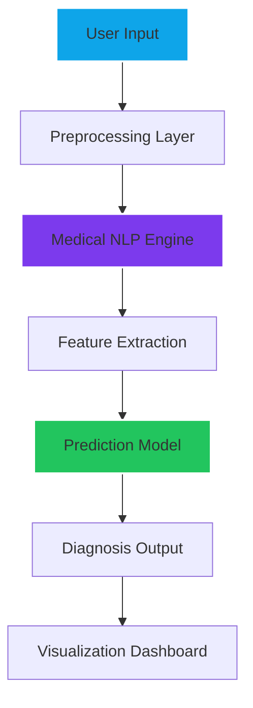

<p align="center">
  
</p>

<div align="center">


[](https://python.org)
[](https://streamlit.io/)
[](https://openai.com/)
[](https://tensorflow.org)

</div>

---

# 🧠 The Clinical Intelligence Protocol

**Med AI** is a **Medical Decision Augmentation System** engineered to interpret patient data, extract diagnostic signals, and generate probabilistic health insights.

It transforms **raw medical input → structured intelligence → actionable outputs**.

---

## ⚙️ Core Intelligence Stack

### 🧬 Neural Processing Pipeline

1. **Data Ingestion Layer**  
   Patient inputs (symptoms, reports, clinical text) are captured and normalized.

2. **Semantic Decomposition**  
   Natural language is converted into structured medical entities.

3. **Clinical Pattern Recognition**  
   AI models detect correlations between symptoms and known conditions.

4. **Inference Engine**  
   Generates predictions, risk probabilities, and medical suggestions.

5. **Visualization Layer**  
   Outputs are rendered into an interactive dashboard.

---

## 🧪 System Capabilities

- 🩺 Symptom-based disease prediction  
- 📄 Medical report summarization  
- 🧠 NLP-driven clinical reasoning  
- ⚡ Real-time inference engine  
- 📊 Structured health insights  

---

## 🧱 Architecture Blueprint



---

## 🚀 Execution Protocol

```bash
# Clone the system
git clone https://github.com/SubashSK777/Med_AI.git

# Enter directory
cd Med_AI

# Install dependencies
pip install -r requirements.txt

# Launch the system
streamlit run app.py
```

---

## 🧠 Intelligence Philosophy

> “Medical AI is not built to replace doctors.  
> It is built to amplify diagnostic precision beyond human limits.”

---

## 🤝 Contribution Protocol

| Phase | Action |
|------|--------|
| **01** | Fork the repository |
| **02** | Engineer improvements |
| **03** | Submit Pull Request |

---

## 🔐 System Notes

- This system is **assistive**, not authoritative  
- Outputs must be validated by medical professionals  
- Designed for **research + augmentation**, not clinical replacement  

---

<p align="center">
  
</p>

<p align="center">
  <i>"Diagnosis is no longer observation. It is computation."</i>
  <br />
  
</p>
